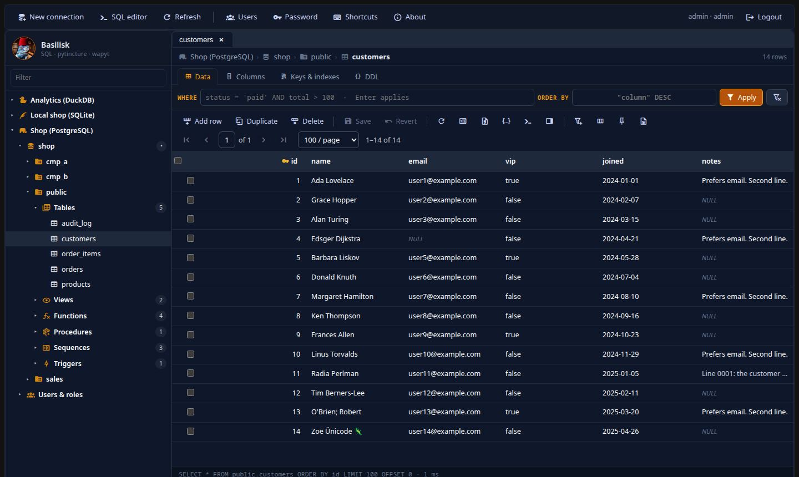
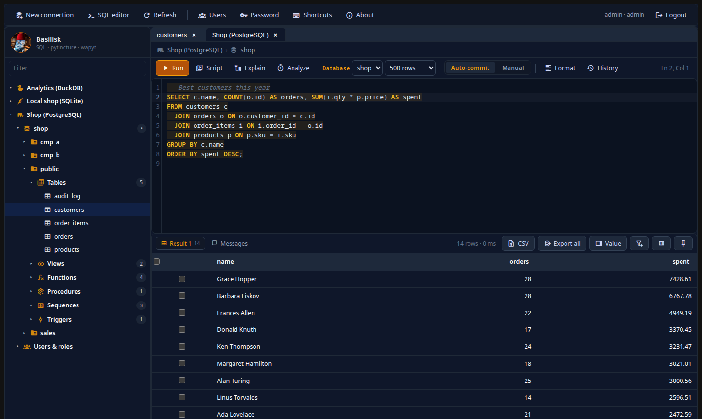
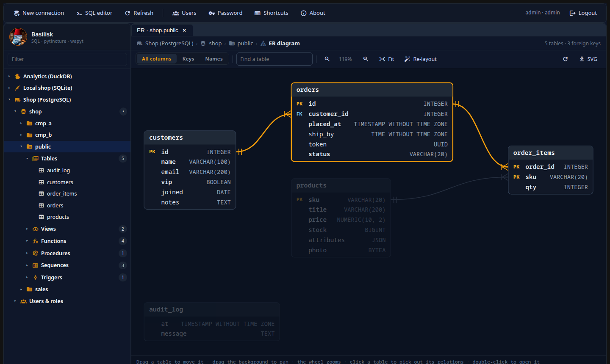
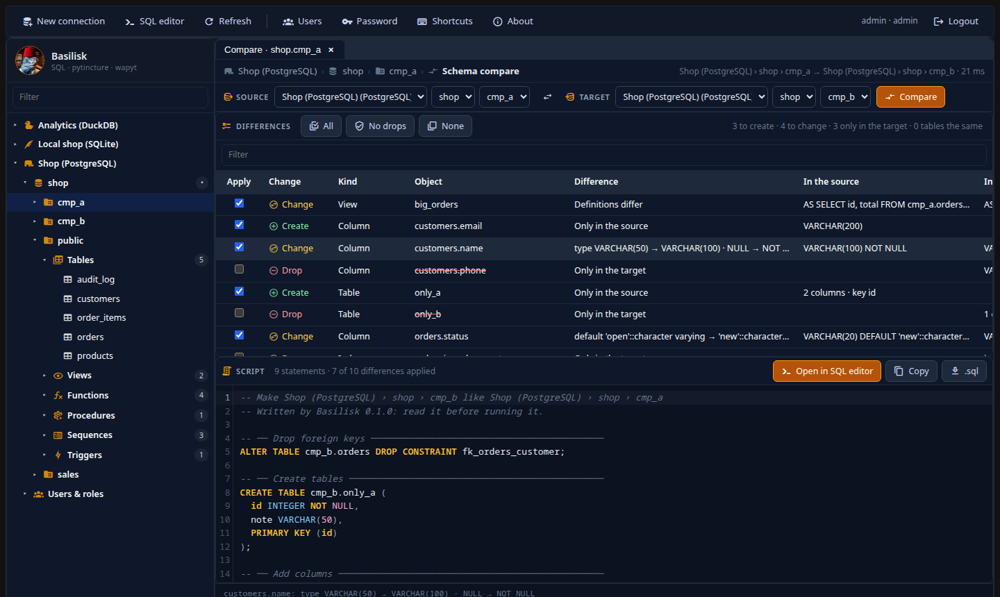

<p align="center">
  
</p>

<h1 align="center">Basilisk</h1>

<p align="center">
  <b>A SQL database manager in your browser — think DBeaver, in a tab.</b><br>
  PostgreSQL · MySQL / MariaDB · SQL Server · SQLite · DuckDB · CockroachDB
</p>

<p align="center">
  <a href="https://github.com/El-Iguana/basilisk_wapyt/releases/latest">Download 0.1.0</a> ·
  <a href="INSTALL.md">Install guide</a> ·
  <a href="https://github.com/El-Iguana/basilisk_wapyt/wiki">Wiki</a> ·
  <a href="ROADMAP.md">Roadmap</a>
</p>

Basilisk is a self-hosted database GUI: browse and edit tables, write SQL with
completion, read explain plans, draw ER diagrams and compare schemas and data
— for several people, each with their own encrypted connections. It is built
on [pytincture](https://github.com/pytincture/pytincture) (the whole interface
is Python running in your browser, through Pyodide) and the
[wapyt](https://github.com/WAwesome-AI/wa_pytincture_widgetset) widget set.



| | |
|---|---|
|  |  |
| **SQL editor** — completion, results, explain plans | **ER diagram** — laid out by foreign keys |
|  | |
| **Schema compare** — the differences and the script that fixes them | |

## What it does

**Browse and edit**
- **Navigator**: connections in folders, then databases, schemas, tables,
  views, functions, procedures, sequences, triggers, and each server's users
  and roles, loaded as you open them. Routines, sequences, triggers and roles
  open with their properties and definition; **Call…** writes a ready-to-fill
  call. PostgreSQL materialized views refresh (concurrently when they can).
- **Table editor**: paged data with WHERE / ORDER BY, sorting by header,
  inline edits that stay pending until **Save** (shown as SQL first, run in one
  transaction), add / duplicate / delete rows, Set NULL; columns, keys,
  indexes, foreign keys (double-click to follow) and DDL.
- **Grids**: column filters as chips (on a table they filter every row on the
  server), hide, move, resize and freeze columns (remembered per table), copy
  rows as INSERT statements or a Markdown table, open the row a foreign key
  points at.
- **Value panel** (F7): a cell's whole value as text, pretty JSON, a hex dump
  or a picture; edit long values there, load from or save to a file.
- **Object actions**: create, rename, truncate and drop tables; add, rename and
  drop columns; create and drop indexes — each previews its SQL as you type.
- **Import CSV** with the delimiter and encoding guessed and columns matched by
  name, in one transaction with progress and Cancel. **Export** tables and
  results to CSV or JSON.

**Query**
- **SQL editor** (CodeMirror): syntax highlighting and completion per dialect,
  run the statement at the cursor or the whole script, cancel, timeouts,
  history, formatting, drafts. Auto-commit or **manual commit** with
  Commit / Rollback.
- **Explain plans**, estimated or with actual rows and times, as one plan grid
  for every engine, with the costly steps shaded.
- **Sessions**: what runs on a PostgreSQL, MySQL / MariaDB or SQL Server
  server, with Cancel query and End session.

**Design and compare**
- **ER diagram** of a schema or of one table and its neighbours: drag tables
  (remembered), keys only or names only, find, export as SVG.
- **Schema compare** between any two schemas — the same server, two servers or
  two engines — with a ticked list of differences and the script, in a safe
  order, that makes the target like the source.
- **Data compare** of two tables by primary key: rows to insert, update and
  delete, and the script for the target, run in the background.

**Run it safely**
- Several accounts, each with their own connections; database passwords and
  SSH keys encrypted at rest.
- **SSH tunnels** to databases only an SSH server can reach, with the host
  key pinned on first use.
- **Read-only** and **production** connections: one cannot change anything,
  the other asks before anything that is not a read.

## Engines

| Engine | Connects to | Notes |
|---|---|---|
| PostgreSQL | a server | materialized views, sessions, savepoints in manual commit |
| MySQL / MariaDB | a server | sessions; MySQL commits DDL as it runs |
| SQL Server | a server | `GO` batches, sessions |
| CockroachDB | a server | PostgreSQL's features, without the sessions list |
| SQLite | a file | in the server's database files folder |
| DuckDB | a file | in the same folder; explain and analyze |

## Install

**[INSTALL.md](INSTALL.md)** goes step by step; in short:

- **With Docker or Podman** on Windows, macOS or Linux:
  ```bash
  git clone https://github.com/El-Iguana/basilisk_wapyt.git && cd basilisk_wapyt
  cp .env.example .env          # set BASILISK_ADMIN_PASS
  docker compose up -d --build  # then open http://127.0.0.1:8768/basilisk
  ```
  `--profile postgres` adds a PostgreSQL to try it with;
  `compose.host-network.yaml` (Linux) reaches databases on the host's
  127.0.0.1.
- **Windows without Docker**: `Basilisk-0.1.0-setup.exe` from the
  [latest release](https://github.com/El-Iguana/basilisk_wapyt/releases/latest)
  — a per-user install with its own Python and a tray icon, no administrator
  rights needed.

Sign in as `admin` (the password from `.env`, or `change_me` with the
Windows installer); Basilisk asks you to choose your own. Use `127.0.0.1`, not
`localhost`.

## Documentation

- **[The wiki](https://github.com/El-Iguana/basilisk_wapyt/wiki)** — using
  Basilisk: connections, the table editor, the SQL editor, explain plans, the
  ER diagram, compares, administration, security and troubleshooting.
- **[INSTALL.md](INSTALL.md)** — installing, updating, backups, reaching it
  from other machines.
- **[ROADMAP.md](ROADMAP.md)** — what is done and what comes next.
- **`CLAUDE.md`** — the design, the test databases and the traps, for working
  on Basilisk.

## Develop

```bash
cp .env.example .env          # set BASILISK_ADMIN_PASS
uv sync
../wa_pytincture_widgetset/scripts/dev_wheel.sh appcode   # the widget set for the browser
uv run python service.py      # http://127.0.0.1:8768/basilisk/
uv run --group dev pytest -q  # the live tests skip databases that are not running
```

`scripts/podman-run.sh` builds the development container (Linux + Podman,
host networking, the sibling wapyt checkout). The test databases and the
browser smoke test are described in `CLAUDE.md`.

MIT licensed.
